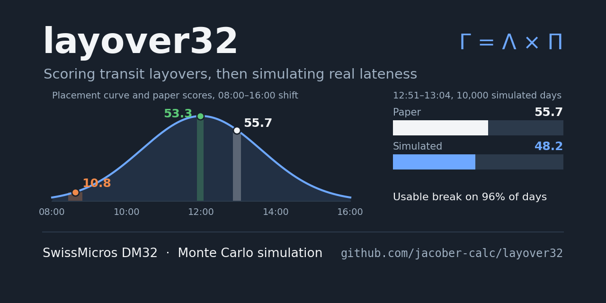
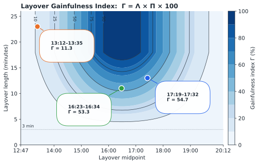
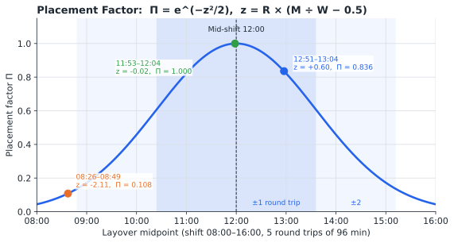
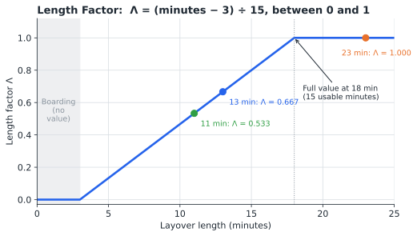
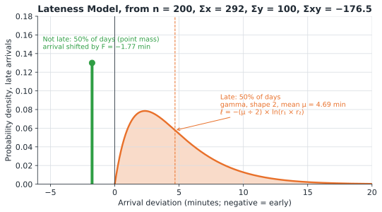
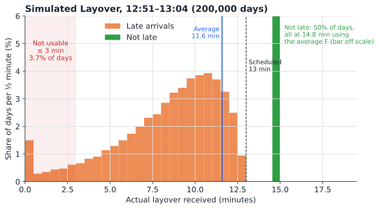
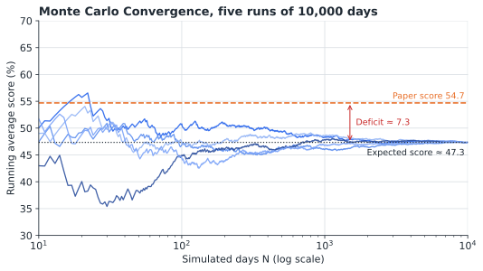
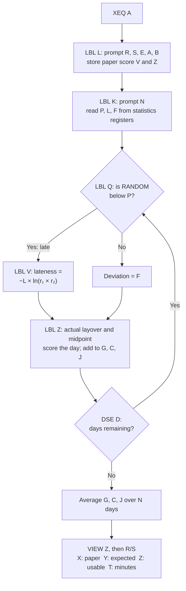

# LAYOVER Statefile

## CONTENTS

1. [Introduction](#1-introduction)
2. [Disclaimer](#2-disclaimer)
3. [Theory of Operations](#3-theory-of-operations)
4. [Variable Definitions](#4-variable-definitions)
5. [Program Descriptions](#5-program-descriptions)
6. [Operating Instructions](#6-operating-instructions)
7. [Example Calculations](#7-example-calculations)
8. [Quick Reference](#8-quick-reference)
9. [Program Listing](#9-program-listing)

---

## 1. INTRODUCTION

This program suite provides transit layover assessment for bus operators and planners. The calculator scores a scheduled layover with the Layover Gainfulness Index, which rates a break on its length and its position in the shift, then uses a Monte Carlo simulation driven by recorded lateness data to estimate what the layover delivers in practice.

### 1.1 Purpose

The program enables operators and planners to:

- Score any scheduled layover on a 0 to 100 scale (the paper score)
- Simulate the layover over many days using real lateness data held in the statistics registers
- Estimate the expected score, the share of days with a usable break, and the average layover length actually received
- Compare the paper score with the simulated score to measure the effect of lateness on a schedule
- Summarize a lateness dataset: the share of arrivals on time or early, the average lateness when late, and the average deviation when not late
- Load a lateness dataset kept in Global registers, so data can be shared between States

### 1.2 System Requirements

SwissMicros DM32 calculator with RPN operating system. Program requires 248 program steps in 10 labels. Statistics registers hold the lateness data; Global registers −328 to −333 are used by LBL I.

### 1.3 Install and Download

Copy **LAYOVER.d32** to the `/STATE` folder of the DM32's internal USB disk, then load it from the calculator. Instructions are available [via the DM32 User Manual](https://technical.swissmicros.com/dm32/doc/dm32_user_manual.html#_saving_and_loading_a_state).

---

## 2. DISCLAIMER

### IMPORTANT NOTICE

This program is an independent analysis tool. It is not produced, endorsed, or used by any transit agency, and the Layover Gainfulness Index is not an industry or regulatory standard. Results depend on the lateness data entered and on the assumptions described in this document. The developer (jacober-calc) makes no warranties, express or implied, regarding the accuracy, completeness, or suitability of this program for any particular purpose.

---

## 3. THEORY OF OPERATIONS

### 3.1 Layover Gainfulness Index

The index scores a layover against a **minimum benchmark: one continuous 15-minute rest at mid-shift**. The benchmark is a floor, not an ideal.

The index rates a layover on two factors, multiplied together, because the benchmark requires both:

- **Length factor (Λ):** the proportion of the 15-minute benchmark rest the layover delivers. The bus must be at the departure position and boarding 3 minutes before departure (the boarding allowance), so those minutes are not rest. A layover must be longer than 3 minutes to give any rest, and full value is reached at 18 minutes: 15 minutes of rest plus 3 of boarding.
- **Placement factor (Π):** a break near the middle of the shift is worth more than one near the start or end. The factor follows a normal curve centred on mid-shift, with one standard deviation equal to one round trip.

A score of 100 means the layover meets the benchmark: at least 18 minutes, centred on mid-shift.

The chart below maps the index across every combination of layover length and position for the example shift in section 7 (08:00 to 16:00, 5 round trips). Three layovers are marked: the two from the examples and an 11-minute break at mid-shift. A long break early in the shift scores lower than a shorter one near the middle.



### 3.2 Key Equations

All times are converted to decimal hours.

#### Shift and Layover Times

Shift length:

$$
W = E - S
$$

Scheduled layover:

$$
U = B - A
$$

Shift start to layover arrival:

$$
T = A - S
$$

Shift start to layover midpoint:

$$
M = T + \frac{U}{2}
$$

#### Placement Factor

$$
z = R\left(\frac{M}{W}-\frac{1}{2}\right), \qquad \Pi = e^{-z^{2}/2}
$$

Where z is the Placement Z-Score: the number of round trips the layover midpoint sits from mid-shift.



Each round trip on either side of mid-shift is one standard deviation. A layover centred one round trip from mid-shift keeps 61% of its value; at two round trips it keeps 14%.

A round trip is measured start to start: from a departure at a terminal to the next departure from the same terminal, including running time in both directions, layover and recovery time, and any deadhead bundled into the cycle. R is therefore the shift length divided by the average cycle time, and need not be a whole number.

#### Length Factor

$$
\Lambda = \min\left(1,\ 4u - 0.2\right)
$$

With $u$ in hours, this is $(\text{minutes} - 3)/15$. The 3 minutes subtracted are the boarding allowance at the end of the layover, when the bus must be at the departure position and boarding; the 15 is the rest needed for full value.



#### Score

$$
\Gamma = 100\,\Lambda\,\Pi
$$

### 3.3 Lateness Data

The Monte Carlo simulation reads the lateness of the trip arriving at the layover from the statistics registers. Each recorded arrival is entered with **Σ+**:

- **X-value:** minutes from schedule (negative early, 0 on time, positive late)
- **Y-value:** 1 if on time or early, 0 if late

From the summation registers, the program calculates:

Chance of a late arrival:

$$
P = \frac{n - \Sigma y}{n}
$$

Average lateness when late, in minutes:

$$
\mu = \frac{\Sigma x - \Sigma xy}{n - \Sigma y}
$$

Average deviation when not late, in minutes:

$$
F = \frac{\Sigma xy}{\Sigma y}
$$

Because Y is 1 only for trips that were not late, Σxy is the sum of the deviations of those trips, and Σx − Σxy is the sum of the late minutes.

LBL R displays these same values in minutes, with the on-time-or-early share 1 − P shown as ȳ × 100, so a dataset can be checked before it is simulated.

The chart shows the model the simulation builds from the dataset used in section 7.3. Late arrivals, half of the dataset, are spread across a gamma curve averaging 4.69 minutes late. The other half arrived on time or early, and they vary too: the green curve is their spread estimated from Σx², with a standard deviation of about 1.8 minutes. The simulation does not draw from that spread. It uses their average, F = −1.77 minutes, for every day the trip is not late.



### 3.4 Monte Carlo Simulation

Each simulated day, a random number decides whether the incoming trip is late:

- **Late (probability P):** lateness is drawn from a gamma distribution with shape 2 and mean μ:

  $$
  \ell = -\frac{\mu}{2}\,\ln\left(r_1 r_2\right)
  $$

  where $r_1$ and $r_2$ are random numbers. Delays are mostly moderate, occasionally long, and never negative.
- **Not late:** the arrival is shifted by the average early deviation F.

Using the average for every non-late day is a simplification with little effect on the results. An early arrival only lengthens the layover, so it never makes a break unusable, and the average early deviation is preserved exactly. For the layover in section 7.3, drawing early arrivals from their estimated spread instead lowers the expected score by about 0.3 points and leaves the usable share and average layover unchanged.

The actual layover is $u = \max(0,\ U - \ell)$, and the actual midpoint is $T + (U + \ell)/2$. The day is scored with the same index as the paper score, and the length factor is held between 0 and 1. A day is counted as usable when its score is greater than zero, that is, when the actual layover exceeds 3 minutes.

The chart shows the actual layover received over 200,000 simulated days for the 12:51–13:04 layover in section 7.3. On days the trip is not late, the simulation uses the average early deviation, so the layover is 14.8 minutes. On late days it is spread below the scheduled 13 minutes, and on 3.7% of days it is 3 minutes or less.



After N days the program reports the averages. Precision improves with the square root of N: for the example in section 7.3, 10,000 days gives the expected score to within about ±0.4 points on 95% of runs.



Each line is an independent run. Early averages swing widely, but all five settle on the same expected score, well below the paper score.

### 3.5 Program Logic Flow



**Program Flow (LBL A):**
1. Prompt for the shift and layover times; calculate and store the paper score V and Placement Z-Score Z (LBL L)
2. Prompt for the number of simulated days N (LBL K)
3. Read P, μ, and F from the statistics registers
4. For each day: decide whether the trip is late (LBL Q), draw the lateness (LBL V), and score the day (LBL Z)
5. Average the results over N days
6. Display the Placement Z-Score, then the paper and simulated results on the stack

---

## 4. VARIABLE DEFINITIONS

| Variable | Description |
|----------|-------------|
| **R** | Round trips per shift |
| **S** | Shift start (H.MM) |
| **E** | Shift end (H.MM) |
| **A** | Layover scheduled arrival (H.MM) |
| **B** | Layover scheduled departure (H.MM) |
| **N** | Number of simulated days |
| **V** | Paper score (%) |
| **Z** | Placement Z-Score |
| **W** | Shift length (hours) |
| **U** | Scheduled layover (hours) |
| **T** | Shift start to layover arrival (hours) |
| **P** | Chance of a late arrival |
| **L** | Gamma scale, $\mu/2$ (hours) |
| **F** | Average deviation when not late (hours; negative = early) |
| **G** | Score total (internal use) |
| **C** | Usable day count (internal use) |
| **J** | Actual layover total, hours (internal use) |
| **D** | Day counter (internal use) |
| **i** | Indirect register pointer (LBL I) |

---

## 5. PROGRAM DESCRIPTIONS

### 5.1 LBL A - Paper vs Simulated

Runs LBL L, then the Monte Carlo simulation from LBL K, and places the paper score above the simulated results on the stack. The program halts with the Placement Z-Score in view; press **R/S** to continue.

**Inputs:** R, S, E, A, B, N

**Outputs (Stack display from top to bottom):**
- T: Average actual layover (minutes)
- Z: Usable share (%)
- Y: Expected score (%)
- X: Paper score (%)

### 5.2 LBL L - Paper Score

Calculates the Layover Gainfulness Index for the scheduled times. Enter an actual arrival time at A to score a real day.

**Inputs:** R (Round trips per shift), S (Shift start), E (Shift end), A (Layover arrival), B (Layover departure)

**Outputs (Stack display from top to bottom):**
- Y: Placement Z-Score
- X: Paper score (%)

### 5.3 LBL M - Monte Carlo Simulation

Prompts for all shift and layover inputs, then runs the simulation.

**Inputs:** R, S, E, A, B, N (Number of simulated days)

**Outputs (Stack display from top to bottom):**
- T: Number of data points in the statistics registers (n)
- Z: Average actual layover (minutes)
- Y: Usable share (%)
- X: Expected score (%)

### 5.4 LBL K - Monte Carlo Entry

Runs the simulation using the R, S, E, A, and B already stored. Use it to rerun a layover with a different N, or after loading a different dataset.

**Input:** N (Number of simulated days)

**Outputs:** As LBL M

### 5.5 LBL I - Load Dataset from Global Registers

Copies Global registers −328 to −333 into statistics registers 28 to 33. Global registers are shared by all States, so a dataset kept there can be used from any State.

| Global register | Statistics register | Contents |
|-----------------|---------------------|----------|
| −328 | 28 | n |
| −329 | 29 | Σx |
| −330 | 30 | Σy |
| −331 | 31 | Σx² |
| −332 | 32 | Σy² |
| −333 | 33 | Σxy |

When the copy is complete, LBL I resets i to 0 and runs LBL R.

**Outputs:** As LBL R

### 5.6 LBL H - Elapsed Time

Calculates the time from a start time in the Y-register to an end time in the X-register, both in H.MM format, and returns decimal hours. Used by all programs; can also be run on its own.

### 5.7 LBL R - Lateness Summary

Summarizes the lateness dataset in the statistics registers. These are the values LBL K uses to drive the simulation.

**Inputs:** None (reads n, Σx, Σy, Σxy, and ȳ)

**Outputs (Stack display from top to bottom):**
- T: Number of data points (n)
- Z: Arrivals on time or early (%)
- Y: Average lateness when late (minutes)
- X: Average deviation when not late (minutes; negative = early)

The average deviation when not late includes on-time arrivals, which count as 0 minutes.

---

## 6. OPERATING INSTRUCTIONS

### 6.1 Recording Lateness Data

Record the arrival of the trip that ends at the layover.

**Procedure:**

1. Before starting a new dataset, clear the statistics registers (`CLEAR Σ`)
2. For each arrival, key in the Y-value, press `ENTER`, key in the X-value, and press `Σ+`
   - Late by 4 minutes: `0` `ENTER` `4` `Σ+`
   - Early by 2 minutes: `1` `ENTER` `2` `+/-` `Σ+`
   - On time: `1` `ENTER` `0` `Σ+`

The dataset must contain at least one late and one non-late arrival.

To check the dataset at any time, press `XEQ R`.

### 6.2 Loading a Dataset from Global Registers (LBL I)

**Procedure:**

1. Press `XEQ I`
2. The lateness summary from LBL R is displayed; check that n matches the expected dataset

### 6.3 Paper vs Simulated (LBL A)

**Procedure:**

1. Press `XEQ A`
2. Enter round trips per shift when prompted (R?)
3. Enter shift start, H.MM, when prompted (S?)
4. Enter shift end, H.MM, when prompted (E?)
5. Enter layover arrival, H.MM, when prompted (A?)
6. Enter layover departure, H.MM, when prompted (B?)
7. Enter the number of simulated days when prompted (N?)
8. The Placement Z-Score is displayed; press `R/S`

**The program will display (from top to bottom on screen):**
- T-register: Average actual layover (minutes)
- Z-register: Usable share (%)
- Y-register: Expected score (%)
- X-register: Paper score (%)

**Note:** Press `x<>y` to switch between the paper and expected scores.

### 6.4 Individual Programs

- **Paper score only:** `XEQ L`, then respond to the R, S, E, A, and B prompts
- **Simulation only:** `XEQ M`, then respond to the R, S, E, A, B, and N prompts
- **Rerun the simulation:** `XEQ K`, then respond to the N prompt
- **Lateness summary:** `XEQ R`

---

## 7. EXAMPLE CALCULATIONS

Results are shown in FIX 6, the display format saved in the Statefile. Simulated results vary slightly from run to run.

### 7.1 Paper Score

**Scenario:**

A shift runs from 08:00 to 16:00 with 5 round trips. The layover is scheduled from 12:51 to 13:04.

**Solution:**

Press: `XEQ L`

| Prompt | Enter | Description |
|--------|-------|-------------|
| R? | 5 | Round trips per shift |
| S? | 8 | Shift start |
| E? | 16 | Shift end |
| A? | 12.51 | Layover arrival |
| B? | 13.04 | Layover departure |

**Results (displayed on screen from top to bottom):**

| Register | Value | Meaning |
|----------|-------|---------|
| Y | 0.598958 | Placement Z-Score |
| X | 55.719464 | Paper score, % |

**Interpretation:**

The 13-minute layover earns a length factor of 0.667. Its midpoint is 0.60 round trips after mid-shift, for a placement factor of 0.836. On paper, the layover delivers 55.7% of the minimum benchmark.

### 7.2 Early Layover

**Scenario:**

On the same shift, a layover is scheduled from 08:26 to 08:49.

**Solution:**

Press: `XEQ L`, and enter 5, 8, 16, 8.26, and 8.49 at the prompts.

**Results (displayed on screen from top to bottom):**

| Register | Value | Meaning |
|----------|-------|---------|
| Y | -2.109375 | Placement Z-Score |
| X | 10.809644 | Paper score, % |

**Interpretation:**

At 23 minutes the layover earns the full length factor, but it begins only 26 minutes into the shift, and its midpoint falls 2.11 round trips before mid-shift. Despite being the longest break, it scores only 10.8%.

### 7.3 Paper vs Simulated

**Scenario:**

The statistics registers hold 200 recorded arrivals: n = 200, Σx = 292, Σy = 100, Σx² = 3939, Σy² = 100, Σxy = −176.5. Half the arrivals were late, by an average of 4.69 minutes; the rest averaged 1.77 minutes early. Assess the 12:51 layover over 10,000 simulated days.

**Solution:**

Press: `XEQ A`

| Prompt | Enter | Description |
|--------|-------|-------------|
| R? | 5 | Round trips per shift |
| S? | 8 | Shift start |
| E? | 16 | Shift end |
| A? | 12.51 | Layover arrival |
| B? | 13.04 | Layover departure |
| N? | 10000 | Simulated days |

The display shows `Z=0.598958`. Press `R/S`.

**Results (displayed on screen from top to bottom):**

| Register | Value | Meaning |
|----------|-------|---------|
| T | ≈ 11.6 | Average actual layover, minutes |
| Z | ≈ 96.3 | Usable share, % |
| Y | ≈ 48.2 | Expected score, % |
| X | 55.719464 | Paper score, % |

**Interpretation:**

The layover promises 55.7 on paper but delivers about 48.2 on average, a deficit of about 7.5 points. The scheduled 13 minutes averages about 11.6 minutes in practice, and on about 4% of days there is no usable break.

### 7.4 Lateness Summary

**Scenario:**

Check the dataset used in section 7.3 before running a simulation.

**Solution:**

Press: `XEQ R`

**Results (displayed on screen from top to bottom):**

| Register | Value | Meaning |
|----------|-------|---------|
| T | 200.000000 | Data points |
| Z | 50.000000 | On time or early, % |
| Y | 4.685000 | Average lateness when late, minutes |
| X | -1.765000 | Average deviation when not late, minutes |

**Interpretation:**

Half of the 200 recorded arrivals were on time or early. Late arrivals averaged 4.7 minutes late, and the rest averaged 1.8 minutes early. These figures correspond to P = 0.5, μ = 4.685, and F = −1.765 in section 3.3.

---

## 8. QUICK REFERENCE

### 8.1 Program Labels

| Label | Function |
|-------|----------|
| **A** | Paper vs simulated comparison |
| **L** | Paper score |
| **M** | Monte Carlo simulation, all inputs |
| **K** | Monte Carlo simulation, stored inputs |
| **I** | Load dataset from Global registers |
| **R** | Lateness summary of the dataset |
| **H** | Elapsed time, H.MM to decimal hours |
| **Q,V,Z** | Simulation subroutines (internal) |

### 8.2 Typical Input Ranges

| Variable | Typical Range |
|----------|---------------|
| **R** | 1 to 10 round trips |
| **S, E, A, B** | 0.00 to 23.59 (H.MM) |
| **N** | 1,000 to 10,000 days |

### 8.3 Important Notes

- Times are entered in H.MM format (12.51 = 12:51); shifts that cross midnight are not supported
- The dataset must contain at least one late and one non-late arrival, or the simulation stops with a divide-by-zero error
- Use data for the specific trip arriving at the layover; a dataset that mixes all trips gives an optimistic result for a layover after a trip that often runs late
- Use `SEED` before running to repeat a simulation exactly
- LBL L does not limit the length factor at zero, so a scheduled layover shorter than 3 minutes produces a negative paper score; the simulation limits it at zero
- LBL H rounds with RND, which follows the display setting; FIX 6 removes conversion error without changing the result
- The simulation assumes the operator departs at the scheduled time: a late arrival reduces the layover by the full delay, and in the worst case the layover is lost entirely. The index therefore measures the rest the schedule delivers while service runs to time
- Days are simulated independently; runs of bad days caused by weather or roadworks are not modelled
- Global registers are not saved in a Statefile and are lost on RESET or firmware update
- Label R and variable R (round trips) are separate on the DM32 and do not interact

---

## 9. PROGRAM LISTING

The complete program listing is provided below. Program steps are shown in standard DM32 RPN format with label-relative line numbers, as displayed on the calculator. The DM32 does not generate checksums.

### LBL L - Paper Score

```
L01  LBL L    Paper score for one layover.
L02  INPUT R  Prompts for round trips per shift.
L03  INPUT S  Prompts for shift start, H.MM.
L04  INPUT E  Prompts for shift end, H.MM.
L05  XEQ H    W = shift length, hours.
L06  INPUT A  Prompts for layover arrival, H.MM.
L07  INPUT B  Prompts for layover departure, H.MM.
L08  XEQ H    U = scheduled layover, hours.
L09  RCL S
L10  RCL A
L11  XEQ H    T = shift start to arrival, hours.
L12  x<>y
L13  2
L14  ÷        U ÷ 2.
L15  +        Midpoint M = T + U ÷ 2.
L16  LASTx
L17  x<>y
L18  R↑       Recovers W.
L19  ÷        M ÷ W.
L20  2
L21  1/x
L22  -        M ÷ W − 0.5.
L23  RCL× R   Placement Z-Score z.
L24  ENTER
L25  x²
L26  -2
L27  ÷
L28  eˣ       Placement factor e^(−z²/2).
L29  R↑       Recovers U ÷ 2.
L30  8
L31  ×        4U.
L32  1.2
L33  -        4U − 0.2 − 1.
L34  x>0?     Caps the length factor
L35  CLx      at 1.
L36  ENTER
L37  1
L38  +        Length factor 4U − 0.2, max 1.
L39  ×        Score = length × placement.
L40  100
L41  ×        Score, %.
L42  STO V    Stores paper score V.
L43  x<>y
L44  STO Z    Stores Placement Z-Score Z.
L45  CLx      Clears stack.
L46  ENTER
L47  ENTER
L48  RCL Z    Y-register: Placement Z-Score.
L49  RCL V    X-register: paper score, %.
L50  RTN
```

### LBL M - Monte Carlo Simulation

```
M01  LBL M    Monte Carlo with all inputs.
M02  INPUT R  Prompts for round trips,
M03  INPUT S  shift start, shift end,
M04  INPUT E
M05  INPUT A  layover arrival, and
M06  INPUT B  layover departure.
```

### LBL K - Monte Carlo Entry

```
K01  LBL K    Monte Carlo entry, inputs stored.
K02  INPUT N  Prompts for simulated days.
K03  RCL S
K04  RCL E
K05  XEQ H
K06  STO W    W = shift length.
K07  RCL A
K08  RCL B
K09  XEQ H
K10  STO U    U = scheduled layover.
K11  RCL S
K12  RCL A
K13  XEQ H
K14  STO T    T = shift start to arrival.
K15  n
K16  Σy
K17  -        Late trips, n − Σy.
K18  Σx
K19  Σxy
K20  -        Late minutes, Σx − Σxy.
K21  x<>y
K22  ÷        Average lateness when late.
K23  LASTx
K24  n
K25  ÷        Chance late, (n − Σy) ÷ n.
K26  STO P    Stores P.
K27  x<>y
K28  120
K29  ÷        Gamma scale: average ÷ 2 ÷ 60.
K30  STO L    Stores L, hours.
K31  Σxy
K32  Σy
K33  ÷        Average deviation when not late.
K34  60
K35  ÷        Converts to hours.
K36  STO F    Stores F (negative = early).
K37  0        Clears score total G,
K38  STO G
K39  STO C    usable count C, and
K40  STO J    layover-hours total J.
K41  RCL N
K42  STO D    Day counter D = N.
```

### LBL Q - Simulated Day Subroutine

```
Q01  LBL Q    One simulated day.
Q02  RANDOM   Random number, 0 ≤ x < 1.
Q03  RCL P
Q04  x>y?     P > random?
Q05  GTO V    If so, the trip is late.
Q06  RCL F    Not late: deviation F.
Q07  GTO Z
```

### LBL V - Late Arrival Subroutine

```
V01  LBL V    Late arrival.
V02  RANDOM
V03  RANDOM
V04  ×        Product of two random numbers.
V05  LN
V06  RCL× L
V07  +/-      Gamma lateness −L × ln(r₁r₂).
```

### LBL Z - Daily Score Subroutine

```
Z01  LBL Z    Scores the day. X: deviation, hours.
Z02  ENTER    Keeps a copy of the deviation.
Z03  RCL+ U
Z04  2
Z05  ÷
Z06  RCL+ T
Z07  RCL÷ W   Actual midpoint ÷ W.
Z08  2
Z09  1/x
Z10  -
Z11  RCL× R   Placement Z-Score.
Z12  x²
Z13  -2
Z14  ÷
Z15  eˣ       Placement factor.
Z16  x<>y
Z17  +/-
Z18  RCL+ U   Actual layover u = U − deviation.
Z19  x<0?     Negative layover?
Z20  CLx      If so, u = 0.
Z21  STO+ J   Adds u to J.
Z22  ENTER
Z23  4
Z24  ×
Z25  1.2
Z26  -        4u − 1.2.
Z27  x>0?
Z28  CLx      Caps length factor at 1.
Z29  ENTER
Z30  1
Z31  +        Length factor 4u − 0.2, max 1.
Z32  x<0?     Below 0?
Z33  CLx      If so, length factor = 0.
Z34  ×        Day's score.
Z35  STO+ G   Adds score to G.
Z36  x>0?     Usable layover?
Z37  1        If so, counts 1.
Z38  STO+ C   Adds to usable count C.
Z39  DSE D    Counts down days.
Z40  GTO Q    Next day.
Z41  RCL J
Z42  RCL÷ N
Z43  60
Z44  ×        Average layover, minutes.
Z45  RCL C
Z46  RCL÷ N
Z47  100
Z48  ×        Usable share, %.
Z49  RCL G
Z50  RCL÷ N
Z51  100
Z52  ×        Expected score, %.
Z53  n        Number of data points n.
Z54  R↓       X: score, Y: usable, Z: minutes,
Z55  RTN      T: n.
```

### LBL H - Elapsed Time Subroutine

```
H01  LBL H    Elapsed time. Y: start, X: end.
H02  →HR      End to decimal hours.
H03  x<>y
H04  →HR      Start to decimal hours.
H05  -        End − start.
H06  60
H07  ×        Minutes.
H08  RND      Rounds to display setting.
H09  60
H10  ÷        Returns hours in X.
H11  RTN
```

### LBL I - Load Dataset from Global Registers

```
I01  LBL I    Loads dataset from Global registers
I02  -328     -328 to -333 into statistics
I03  STO i    registers 28 to 33.
I04  RCL(i)
I05  28
I06  STO i
I07  x<>y
I08  STO(i)   n.
I09  -329
I10  STO i
I11  RCL(i)
I12  29
I13  STO i
I14  x<>y
I15  STO(i)   Σx.
I16  -330
I17  STO i
I18  RCL(i)
I19  30
I20  STO i
I21  x<>y
I22  STO(i)   Σy.
I23  -331
I24  STO i
I25  RCL(i)
I26  31
I27  STO i
I28  x<>y
I29  STO(i)   Σx².
I30  -332
I31  STO i
I32  RCL(i)
I33  32
I34  STO i
I35  x<>y
I36  STO(i)   Σy².
I37  -333
I38  STO i
I39  RCL(i)
I40  33
I41  STO i
I42  x<>y
I43  STO(i)   Σxy.
I44  0        Resets i to 0.
I45  STO i
I46  XEQ R    Shows lateness summary.
I47  RTN
```

### LBL A - Paper vs Simulated

```
A01  LBL A    Paper vs simulated comparison.
A02  XEQ L    Paper score; prompts R, S, E, A, B.
A03  XEQ K    Monte Carlo; prompts N.
A04  RCL V    X-register: paper score.
A05  VIEW Z   Displays Placement Z-Score.
A06  RTN      Press R/S to clear VIEW.
```

### LBL R - Lateness Summary

```
R01  LBL R    Lateness summary of dataset.
R02  ȳ        Mean of y = share not late.
R03  100
R04  ×        On time or early, %.
R05  Σx
R06  Σxy
R07  -        Late minutes, Σx − Σxy.
R08  n
R09  Σy
R10  -        Late trips, n − Σy.
R11  ÷        Average lateness when late, min.
R12  Σxy
R13  Σy
R14  ÷        Average deviation when not late.
R15  n        Number of data points.
R16  R↓       X: not late, Y: late, Z: %, T: n.
R17  RTN
```

---

### By jacober-calc for SwissMicros DM32

> - [SwissMicros Website](https://www.swissmicros.com)
> - [DM32 product page](https://www.swissmicros.com/en/products/dm32)
> - [SwissMicros full products page](https://www.swissmicros.com/en/shop)
> - [DM32 Online User Manual](https://technical.swissmicros.com/dm32/doc/dm32_user_manual.html)
> - [SwissMicros Calculator Forum](https://forum.swissmicros.com/index.php)
