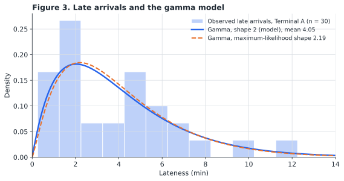

# Layover Gainfulness Index: Method and Rationale

**jacober-calc**

---

## Abstract

In many urban transit operations, operators working continuous pieces of about eight hours receive no scheduled break; the only rest available is the time left at layovers between trips. This paper sets out a method for scoring that rest, the Layover Gainfulness Index (Γ), and explains the reasoning behind each decision in its design. Each layover is scored against a minimum benchmark, one continuous 15-minute rest at mid-shift, from its length and its position in the piece. A simulation using recorded arrival times then estimates the score a layover delivers in practice. Where a decision involves judgment, the paper states the alternatives considered and the evidence for the choice made, and shows that the method's comparative conclusions do not depend on the particular values chosen.

---

## Contents

- [1. Purpose and Scope](#1-purpose-and-scope)
- [2. Origins and Development](#2-origins-and-development)
- [3. Decision 1: The Benchmark](#3-decision-1-the-benchmark)
- [4. Decision 2: The Boarding Allowance](#4-decision-2-the-boarding-allowance)
- [5. Decision 3: The Length Factor](#5-decision-3-the-length-factor)
- [6. Decision 4: The Placement Factor](#6-decision-4-the-placement-factor)
- [7. Decision 5: Combining Length and Placement](#7-decision-5-combining-length-and-placement)
- [8. Decision 6: Departures Run on Schedule](#8-decision-6-departures-run-on-schedule)
- [9. Decision 7: The Lateness Model](#9-decision-7-the-lateness-model)
- [10. Decision 8: Trip-Specific Data](#10-decision-8-trip-specific-data)
- [11. Robustness](#11-robustness)
- [12. Estimating the Delivered Score](#12-estimating-the-delivered-score)
- [13. Limitations](#13-limitations)
- [14. Implementation](#14-implementation)
- [References](#references)

---

## 1. Purpose and Scope

Schedulers build layover and recovery time into transit schedules to protect on-time performance. Where operators remain on duty for the whole shift, that time is also their only rest. The Layover Gainfulness Index is designed to let planners compare layovers by the rest they provide, both as scheduled and as delivered when trips arrive late.

The method applies to continuous pieces of work of approximately eight hours. It scores individual layovers for comparison; it does not combine them into a score for a whole piece.

The method involves eight design decisions. Sections 3 to 10 take them in turn.

---

## 2. Origins and Development

The method began as a personal project of a programmable-calculator enthusiast, as an exercise in using the statistical functions of an RPN calculator on real data: the arrival deviations of the trips in a piece of work on an urban route. The records showed that layovers of similar scheduled length delivered very different amounts of rest, depending on where they fell in the piece and how reliably the trip before them arrived. The index was developed to measure that difference, and its purpose is practical: to compare the layovers of different pieces of work and identify which deliver the most rest.

The method was refined against the data as it grew. An exponential model of lateness was considered first and rejected, because the observed spread of late arrivals was smaller than an exponential distribution implies; a gamma distribution of shape 2 was adopted instead. A Monte Carlo estimate of the delivered score, initially assumed to require a computer, was implemented on the calculator itself, reading directly from its statistics registers. When the data showed that reliability differed between trips, collection was reorganised to record each trip separately.

The method runs on an unmodified SwissMicros DM32 calculator with standard firmware. A 10,000-day simulation of one layover takes 38.2 seconds, about 260 simulated days per second, with no computer or network connection.

---

## 3. Decision 1: The Benchmark

**Decision.** A layover is measured against one continuous 15-minute rest at mid-shift. A layover meeting this benchmark scores 100.

**Reasoning.** British Columbia's *Employment Standards Act* requires a meal break of at least half an hour within every five consecutive hours of work (s.32(1)). For transit operators this standard is commonly displaced: a break during which the employee must remain available for work counts as time worked (s.32(2)), and collective agreement provisions on hours of work can replace the statutory requirements (s.3(2)). Schedules of this kind cannot meet the statutory standard, so measuring against it would show only that every layover fails. The benchmark is instead scaled down from it, to the least that can reasonably stand in for a break:

- **15 minutes** is half the statutory meal break and the standard unit of a rest break in Canadian workplaces, where collective agreements commonly provide two 15-minute rest periods in a shift of about eight hours (for example, HSAA, Article 10).
- **Mid-shift** leaves four hours of work on either side of the break in an eight-hour piece, so neither stretch exceeds the five-hour statutory limit, and the working time is divided equally.

**Alternatives considered.** Using the statutory 30-minute break as the benchmark was rejected because no layover in such a schedule would score above zero, which defeats comparison. A benchmark placed at the statutory five-hour limit was rejected because it leaves the first stretch of work at the limit and the second shorter, rather than dividing the work equally.

The benchmark is a floor, not an ideal: it represents a quarter of the breaks common in an eight-hour shift in other sectors.

---

## 4. Decision 2: The Boarding Allowance

**Decision.** The first β = 3 minutes are subtracted from every layover before scoring.

**Reasoning.** Operators must be at the departure position and boarding passengers a set time before scheduled departure. In the operation studied, this lead time is 3 minutes, marked by the automatic change of the vehicle's destination sign. Those minutes fall at the end of the layover and cannot be used for rest. β is an operational parameter: operations with a different boarding lead time use their own value.

---

## 5. Decision 3: The Length Factor

**Decision.** Credit for length is linear: each minute of rest counts equally, from none at $\beta$ minutes to full credit at $\beta + 15$ minutes.

$$
\Lambda = \min\left(1,\ \max\left(0,\ \frac{u-\beta}{15}\right)\right)
$$

where u is the layover length in minutes.

**Reasoning.** The index measures how much of the benchmark break the schedule delivers, not how rested the operator becomes. A layover giving 7.5 minutes of rest delivers half of the 15 minutes owed and receives half the credit. Under this interpretation each minute is an equal part of the rest owed, and linear credit follows directly.

**Alternative considered.** A recovery-weighted length factor, rising quickly over the first minutes of rest and more slowly after, would reflect the common view that the early minutes of a break restore the most, and would give short layovers more credit. It was not adopted because the index is intended to measure delivery against a benchmark rather than physiological recovery, and because there is no established rate of recovery for the mixed physical and mental fatigue of bus operation. Its effect on the method's conclusions is tested in Section 11, using

$$
\Lambda_\tau = \frac{1-e^{-r/\tau}}{1-e^{-15/\tau}}, \qquad r = u-\beta, \quad 0 \le r \le 15
$$

where $\tau$ is a recovery time constant in minutes.

---

## 6. Decision 4: The Placement Factor

**Decision.** Credit for position follows a normal curve centred on mid-shift, with a standard deviation of one round trip:

$$
z = R\left(\frac{M}{W}-\frac{1}{2}\right), \qquad \Pi = e^{-z^{2}/2}
$$

where W is the length of the piece, M is the time from the start of the piece to the layover's midpoint, and R is the number of round trips in the piece.

**Reasoning.** A break is most valuable where it divides the work most evenly, and its value should fall away smoothly, not abruptly, as it moves from that point. A normal curve has both properties. A round trip is measured start to start, from a departure at a terminal to the next departure from the same terminal, the usual planning definition of cycle time, so $W/R$ is the average cycle time. The cycle is used as the unit of distance because a layover occurs at a terminal and can be moved by a scheduler only in steps of whole cycles. A layover one cycle from mid-shift receives 61% of the placement credit, and one two cycles away 14%.

**Alternative considered.** A width based on the statutory limit, one hour, would give a layover anywhere in the window from hour 3 to hour 5, which keeps both stretches of work within five hours, at least 61% of the placement credit. It ties the width to regulation rather than to the schedule, and is tested in Section 11. In the calculator implementation it is obtained by entering $R = 8$ for an eight-hour piece.

---

## 7. Decision 5: Combining Length and Placement

**Decision.** The two factors are multiplied.

$$
\Gamma = 100\,\Lambda\,\Pi
$$

**Reasoning.** The benchmark requires both conditions: a layover delivers it only if it is long enough *and* well placed. Under multiplication, a deficiency in one factor cannot be offset by the other. A full-length layover at the start of the piece scores near zero, as does a well-placed layover too short to rest in.

**Alternative considered.** An additive index was rejected because it would award substantial credit to either of those layovers, although neither provides a usable break.

---

## 8. Decision 6: Departures Run on Schedule

**Decision.** Each layover ends at its scheduled departure time. A late arrival reduces the layover by the full amount of the delay; an arrival at or after the departure time eliminates it.

**Reasoning.** Operators sometimes take part of a break and depart late, but this behaviour is irregular and unmeasurable. Excluding it means the index measures the rest the schedule delivers while service runs to time. The assumption is conservative: in the worst case, a layover is lost entirely.

---

## 9. Decision 7: The Lateness Model

**Decision.** The arrival data for each layover are summarised by three statistics: the proportion of late arrivals P, the mean lateness of late arrivals μ, and the mean deviation of on-time and early arrivals F. In simulation, a late arrival is drawn from a gamma distribution with shape 2 and mean μ; an on-time or early arrival takes the value F. A shape-2 gamma variate is the sum of two exponential variates, so a late arrival can be generated from two uniform random numbers $r_1$ and $r_2$:

$$
\ell = -\frac{\mu}{2}\,\ln\left(r_1 r_2\right), \qquad r_1, r_2 \sim \mathrm{U}(0,1)
$$

**Reasoning.** The model needs only the totals that a programmable calculator accumulates when each arrival is entered as $x$ = deviation and $y = 1$ for on time or early, $y = 0$ for late:

$$
P = \frac{n-\sum y}{n}, \qquad
\mu = \frac{\sum x-\sum xy}{n-\sum y}, \qquad
F = \frac{\sum xy}{\sum y}
$$

A gamma distribution of shape 2 describes delays that are never negative, usually moderate and occasionally long. Using the mean for early arrivals keeps the model to these three statistics; early arrivals only lengthen a layover, so their spread has little effect on its score.

**Evidence.** Arrival deviations recorded at the start of eight layovers on 21 service days (168 arrivals) support both simplifications:

- Maximum-likelihood estimates of the gamma shape ranged from 1.5 to 2.6 across groups of trips, and a likelihood-ratio test did not reject shape 2 for any group (Figure 1).
- Replacing F with draws from the observed early deviations changed delivered scores by at most a quarter of a point.
- Scores estimated by the model agreed with scores calculated directly from the observed deviations to within 0.8 points for every layover.

---

## 10. Decision 8: Trip-Specific Data

**Decision.** Each layover is simulated with arrival data for the specific trip that arrives at it, not with route or network averages.

**Reasoning.** Lateness differs between trips on the same route, typically by time of day, and the layover after an unreliable trip loses more than the average suggests. In the data, the proportion of late arrivals differed across the four trips arriving at the same terminal (χ², p = 0.053), and the least reliable arrival was a deadhead following an interlined trip. Scoring the layover after that deadhead with the pooled route data gave 53.9, close to its paper score of 54.7; its own data gave 40.9. Pooled data would have concealed most of the loss.

---

## 11. Robustness

Decisions 1 to 4 involve judgment. To test whether the method's conclusions depend on them, each was varied and the eight observed layovers in the piece, labelled L2 to L9 in order, were rescored (Table 1). In the baseline, L5, an 11-minute layover close to mid-shift, delivers the most rest in practice, and L6, a 13-minute layover after the deadhead, scores highest on paper but loses the most to lateness. The conclusions examined were which layover delivers the most rest in practice, which loses the most to lateness, and the overall ranking.

**Table 1. Conclusions under alternative design decisions**

| Variation | Best layover in practice | Largest loss | Rank agreement with baseline (Kendall τ) |
|---|---|---|---|
| Baseline (β = 3, rest 15, width 1 cycle, linear) | L5 | L6 | 1.00 |
| Boarding allowance β = 2 or 4 min | L5 | L6 | 1.00 |
| Benchmark rest 12 or 20 min | L5 | L6 | 1.00 |
| Placement width 0.8 or 1.25 cycles | L5 | L6 | 1.00 |
| Placement width 60 min (statutory window) | L5 | L6 | 0.93 |
| Recovery-weighted length factor, τ = 3, 5 or 8 min | L5 | L6 | 1.00 |

The absolute scores change with the design decisions, as expected; the comparisons do not. The index is therefore best read comparatively, to rank layovers and identify where scheduled rest is lost, and its conclusions in that use do not rest on the particular values chosen.

---

## 12. Estimating the Delivered Score

The **paper score** is Γ for the layover as scheduled. The **delivered score** accounts for the deviation ℓ of the arriving trip (positive when late), with the departure fixed:

$$
u = \max(0,\ U-\ell), \qquad M = T+\frac{U+\ell}{2}
$$

where U is the scheduled layover and T the time from the start of the piece to the scheduled arrival. Each simulated day draws ℓ from the lateness model of Section 9; the delivered score is the mean of Γ over the simulated days, and the share of days on which u exceeds β is the usable share. The difference between the paper and delivered scores is the rest lost to lateness.

---

## 13. Limitations

- The evidence comes from one piece observed by one observer on 21 days, with deviations rounded to the nearest half minute.
- Breaks taken informally at the cost of late departure are not modelled.
- Arrival deviations on the same day are correlated, so the method should not be extended to whole pieces without modelling that dependence.
- The index has not been compared with operators' own ratings of layovers. Such a comparison is the most important next step.

---

## 14. Implementation

The method is implemented in the LAYOVER Statefile for the SwissMicros DM32 calculator: LBL L calculates the paper score, LBL K and LBL M the delivered score, and LBL R the lateness summary.

---

## References

British Columbia. *Employment Standards Act*, RSBC 1996, c. 113, ss. 3 and 32.

HSAA (Health Sciences Association of Alberta). Collective agreement, Article 10: Rest periods and meal periods. Retrieved from hsaa.ca.